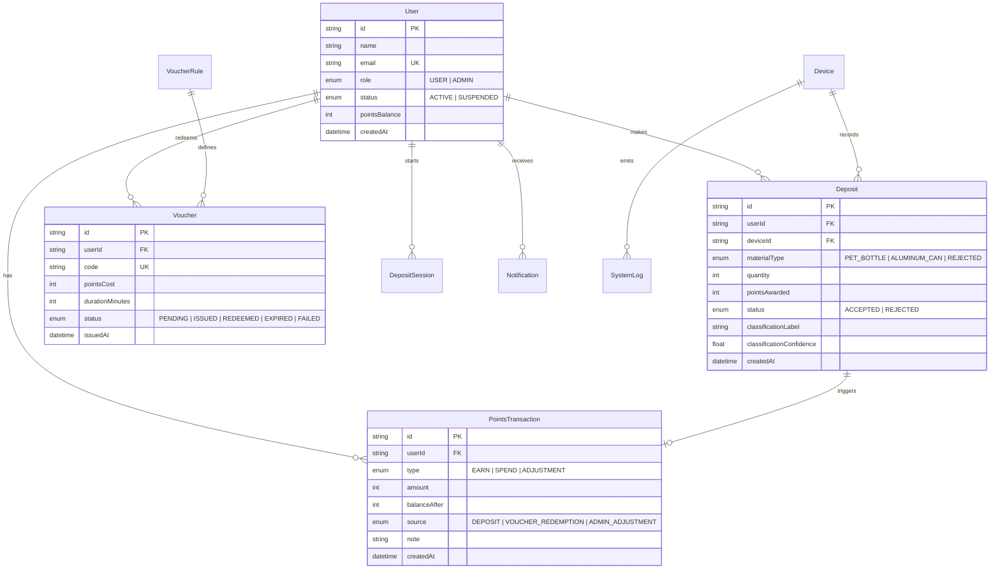

# Fibott: Complete System Documentation

**System Version:** 2.3  
**Classification:** Reverse Vending Machine (RVM) & Wi-Fi Incentive Network  
**Hardware Platform:** Dual-ESP32 (AI-Thinker ESP32-CAM + DevKit Controller via ESP-NOW)  
**Backend & Web:** Next.js 16 (App Router), Neon Serverless PostgreSQL, Prisma ORM, Auth.js  
**Network Infrastructure:** MikroTik RouterOS (hAP ax lite / Captive Portal HotSpot)  
**Export Tools:** SheetJS (Excel Database Export), jsPDF & autoTable (Granular PDF Reports)  

---

## 1. Executive Summary

**Fibott** is an intelligent reverse vending machine (RVM) and public incentive platform designed to encourage ecological waste diversion. Recyclers deposit recyclable plastic bottles (`PET_BOTTLE`) and aluminum beverage cans (`ALUMINUM_CAN`) into a physical smart kiosk. 

An on-device **TinyML computer vision classifier** running directly on an AI-Thinker ESP32-CAM identifies the material in real-time. Upon successful identification, an actuator gate opens wirelessly via **ESP-NOW**, welcoming the recyclable material into the receptacle. 

Deposited items award digital points to the user's account. These points can be redeemed on a mobile web application for **MikroTik HotSpot Wi-Fi vouchers**, providing instant, high-speed internet access in public spaces, university campuses, and municipal venues.

---

## 2. System Architecture & Network Topology

```text
                               +----------------------------------+
                               |         Public Internet          |
                               +-----------------+----------------+
                                                 |
                                                 v
                               +----------------------------------+
                               |     MikroTik hAP ax lite         |
                               |  - HotSpot Captive Portal        |
                               |  - SSID: "Fibott" (Open)         |
                               |  - Walled Garden: Allowed Hosts  |
                               +--------+----------------+--------+
                                        |                |
                       +----------------+                +---------------+
                       |                                                 |
                       v                                                 v
           +-----------------------+                         +-----------------------+
           | Mobile Client Browser |                         |   Physical Smart      |
           |  - PWA / Next.js Web  |                         |   Fibott Kiosk        |
           |  - User Wallet & Auth |                         +-----------+-----------+
           |  - Session Activation |                                     |
           +-----------+-----------+                                     |
                       |                                                 |
                       |                                                 |
                       +----------------+                +---------------+
                                        |                |
                                        v                v
                        +-----------------------------------------------+
                        |        Cloud Application Layer (Next.js)      |
                        |  - Auth.js v5 (Credentials & Google OAuth)    |
                        |  - Deposit Intake API (/api/device/...)       |
                        |  - Points & Ledger Engine (Atomic Updates)    |
                        |  - Dynamic Reports & PDF Export Suite         |
                        |  - Leaderboard Rewards & Admin Management     |
                        +-----------------------+-----------------------+
                                                |
                                                v
                        +-----------------------------------------------+
                        |      Neon Serverless PostgreSQL Database       |
                        |  - Users, Sessions & Deposit Sessions         |
                        |  - Deposits, PointsTransactions, Vouchers     |
                        |  - SystemLogs & AuditLogs                     |
                        +-----------------------------------------------+
```

### Dual-ESP32 100% Wireless Kiosk Architecture

The physical kiosk consists of two isolated microcontrollers communicating via Espressif ESP-NOW:

```text
  [ User approaches kiosk & starts 3-minute session on mobile app ]
                                 |
                                 v
   +-----------------------------------------------------------+
   |              Node 1: AI-Thinker ESP32-CAM                 |
   |  - OV2640 Camera Sensor                                   |
   |  - 96x96 INT8 MobileNetV1 Vision Model in PSRAM           |
   |  - Polls backend to claim active user session             |
   |  - Classifies item: PET_BOTTLE or ALUMINUM_CAN            |
   +-----------------------------+-----------------------------+
                                 |
                                 | 2.4 GHz ESP-NOW (Sub-10ms, Wireless)
                                 v
   +-----------------------------------------------------------+
   |               Node 2: ESP32 Actuator Controller           |
   |  - SG90 / MG90S Micro Servo on GPIO 18                    |
   |  - Status Indicator LED on GPIO 2                         |
   |  - Receives "CMD:OPEN" packet and opens intake chute gate |
   |  - Closes gate after deposit completion cycle             |
   +-----------------------------------------------------------+
                                 |
                                 v
   [ Node 1 uploads deposit telemetry & image to Next.js API ]
```

---

## 3. Database Architecture & Schema Models

The database is built on **PostgreSQL** (hosted on Neon Serverless) managed by **Prisma ORM**.



### Key Models

1. **`User`**: Account identity, hashed passwords, OAuth profiles, role-based access (`USER` vs `ADMIN`), and live `pointsBalance`.
2. **`DepositSession`**: Time-boxed 3-minute session initiated by the user on the mobile app. Associates incoming device deposits to the correct user.
3. **`Deposit`**: Physical record of deposited item, including classified material type, confidence score, points awarded, and timestamp.
4. **`PointsTransaction`**: Double-entry audit ledger recording every balance change (`EARN`, `SPEND`, `ADJUSTMENT`) with a running `balanceAfter`.
5. **`Voucher` & `VoucherRule`**: Wi-Fi redemption packages (e.g. 30 Min WiFi for 50 pts, 1 Hour WiFi for 100 pts) and created voucher credentials (`FBT-XXXX-XXXX-XXXX`).
6. **`RewardRule`**: Point multipliers per material type (e.g., 5 pts per Plastic Bottle, 10 pts per Aluminum Can).
7. **`LeaderboardRewardSetting`**: Monthly reward amounts configured for Top 1, Top 2, and Top 3 recyclers.
8. **`MonthlyLeaderboardAward`**: Historical record of monthly reward disbursements preventing double-payouts.
9. **`SystemLog`**: Real-time diagnostic stream from hardware and cloud systems with `INFO`, `WARN`, and `ERROR` levels.

---

## 4. Key Functional Features

### 4.1 Admin Reports & Analytics Overhaul

The Admin Reports page (`/admin/reports`) provides high-level business intelligence, operational auditing, and granular PDF document printing:

* **Removed "Rejected" Metrics**: The reporting interface strictly focuses on validated recycling volume (Plastic Bottles, Aluminum Cans, and Accepted Totals) without distracting reject counts.
* **Dynamic Timeframe Switching**: Admins can toggle between **Today** (last 24 hours), **Week** (last 7 days), and **Month** (last 30 days). All KPI badges, activity bar charts, recent deposits, and transaction tables update dynamically via API query parameters (`?period=day|week|month`).
* **Complete Transaction History**: A dedicated transaction log displays each ledger movement within the selected period, complete with user identity, transaction type, source, point change, ending balance, and administrative notes.
* **Dedicated, Single-Role PDF Exports**: Rather than bundling all disparate data into one overwhelming document, each section provides its own standalone, branded PDF export:
  1. `fibott-summary-[period]-[date].pdf`: Key recycling metrics, material distribution, registered and active user stats.
  2. `fibott-top-users-[date].pdf`: Leaderboard ranking with deposit totals and current points balances.
  3. `fibott-deposits-[period]-[date].pdf`: Chronological accepted deposit events with material types and awarded points.
  4. `fibott-transactions-[period]-[date].pdf`: Ledger audit trail with source breakdown, amounts, and ending balances.

### 4.2 Interactive Rewards & Leaderboard Distribution

* **Monthly Leaderboard Rewards**: Admins can configure the points awarded to the Top 3 recyclers every month (e.g., 500 / 300 / 100 points).
* **Base-UI Modal Confirmation**: Replaced browser popups (`window.confirm`) with an accessible, high-contrast **Dialog Popup Modal**:
  - Displays target distribution, period name, and recipient criteria.
  - Detects if rewards were already distributed for the month and prompts the admin with a guarded **Force Re-Award** option.
* **Direct User Points Grant**: From `/admin/users`, administrators can open the `AdminGrantPointsDialog` to directly award bonus points to specific users with pre-selected chips (+50, +100, +250, +500, +1000) and mandatory reason tracking.

### 4.3 Wi-Fi Captive Portal & MikroTik HotSpot Integration

1. Users redeem points for a voucher code (`FBT-XXXX-XXXX-XXXX`).
2. When the user taps **"Use Voucher"**, the code is automatically copied to the clipboard, and the captive portal login page (`http://192.168.88.1/login`) opens in the browser.
3. The user inputs their code into both Username and Password fields.
4. MikroTik verifies the user account against the local user database (populated via RouterOS direct REST or outbound sync polling at `/api/mikrotik/sync`).
5. Internet access is activated for the allotted duration.

---

## 5. Database Export Spreadsheet (`fibott_database_export.xlsx`)

A comprehensive database export utility has been generated in the root directory:

* **File Location:** [`fibott_database_export.xlsx`](file:///c:/Users/PC/Fibott/fibott_database_export.xlsx)
* **File Size:** ~2.72 MB
* **Total Worksheets:** 12 Tabs
* **Data Summary:**
  - **`Users`**: 1,023 user records (including 1,000 seeded dummy recyclers + administrative test accounts).
  - **`Deposits`**: 2,000 accepted recycling events (PET bottles & aluminum cans with ML confidence scores).
  - **`PointsTransactions`**: 388 points ledger entries (deposits, redemptions, and manual grants).
  - **`Vouchers`**: 55 Wi-Fi vouchers with duration, status, and redemption details.
  - **`RewardRules`**: Active point allocation rules per material.
  - **`VoucherRules`**: Active Wi-Fi package rules.
  - **`Devices`**: Registered kiosk hardware nodes.
  - **`DepositSessions`**: 434 kiosk intake sessions.
  - **`SystemLogs`**: 2,000 hardware & cloud diagnostic telemetry records.
  - **`LeaderboardSettings`**: Configured Top 3 monthly points awards.
  - **`MonthlyAwards`**: Historical award records.
  - **`Notifications`**: User broadcast and transactional alerts.

To regenerate this export at any time, run:
```bash
npx tsx scripts/export-database-to-excel.ts
```

---

## 6. Developer & Operations Quick Reference

### Environment Variables (`.env.local`)

```ini
DATABASE_URL="postgresql://[user]:[password]@[neon-host]/fibott?sslmode=require"
NEXTAUTH_SECRET="[secure-random-token]"
NEXTAUTH_URL="http://localhost:3000"
MIKROTIK_HOST="192.168.88.1"
MIKROTIK_USER="admin"
MIKROTIK_PASSWORD="[router-password]"
MIKROTIK_HOTSPOT_PROFILE="1hour"
```

### Essential CLI Commands

```bash
# Start Next.js local development server
npm run dev

# Run TypeScript static check
npx tsc --noEmit

# Run ESLint validation
npm run lint

# Export complete database to Excel workbook
npx tsx scripts/export-database-to-excel.ts

# Populate database with 1,000 dummy recyclers and logs
npx tsx prisma/seed-1000.ts

# Build production bundle
npm run build
```

---

*Documentation maintained by the Fibott Engineering Team.*
